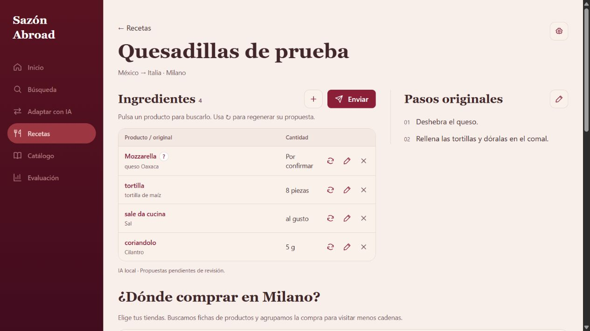
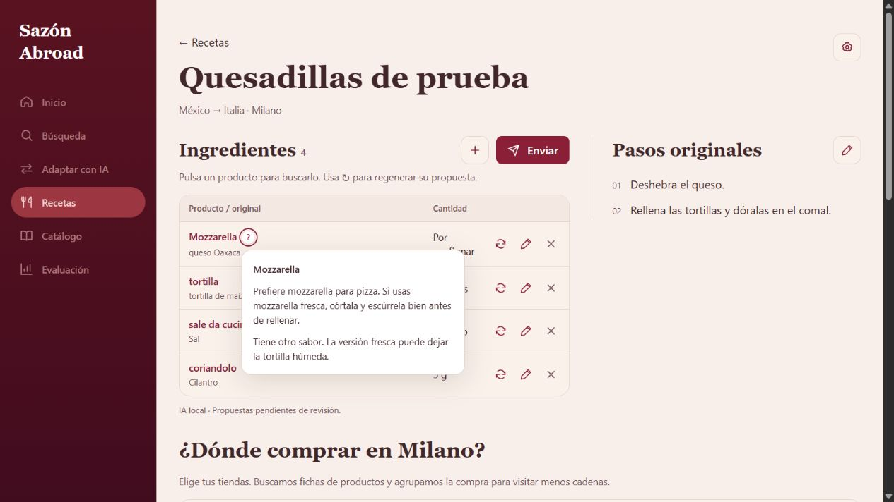
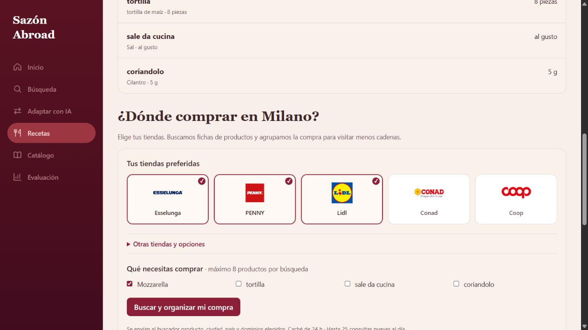
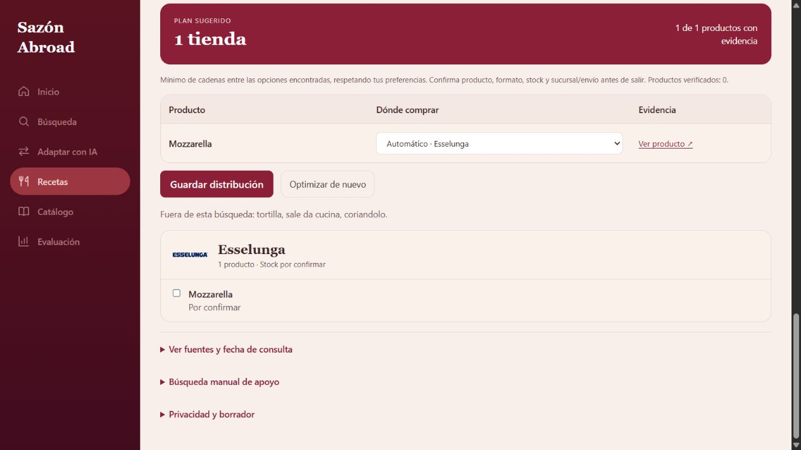

# Lista compacta y compra por tienda

Implementado y comprobado el 25 de noviembre de 2026.

## Recorrido

1. La tabla única de **Ingredientes** reúne el producto propuesto como nombre principal, el original como subtítulo y una sola cantidad de compra. Sustituye las secciones separadas de lista y cambios. El icono **?** conserva notas y presentación, accesibles por ratón, teclado o clic. El nombre abre la búsqueda manual y **↻** regenera esa fila. Los pasos están a la derecha en escritorio y debajo en móvil. La consolidación interna de productos compatibles para las tiendas se conserva.
2. En **¿Dónde comprar?**, selecciona las tarjetas de Esselunga, PENNY, Lidl, Conad o Coop. Son preferencias, no afirmaciones de disponibilidad. En otros países se pueden introducir hasta tres dominios de comercios en **Otras tiendas y opciones**; no es necesario ampliar un catálogo de alimentos.
3. Elige hasta ocho productos, omitiendo lo que ya tienes, y pulsa **Buscar y organizar mi compra**. Primero consulta los dominios preferidos. Si un producto no tiene resultados pertinentes y autorizaste otras cadenas, hace una segunda consulta limitada a las demás cadenas configuradas para ese país.
4. La tabla muestra una asignación por producto y su evidencia. El selector permite fijar otra tienda encontrada. **Guardar distribución** respeta esa elección; **Optimizar de nuevo** elimina las asignaciones manuales. Ninguno de estos botones consume búsquedas.
5. Las listas finales por negocio reúnen las cantidades y permiten marcar lo comprado. Las marcas se conservan en este navegador mediante almacenamiento local; no se sincronizan entre dispositivos.

## Filtrado y optimización

La búsqueda usa `include_domains` con modo `restrict` y vuelve a validar los dominios recibidos. Bloquea redes sociales, foros y destinos privados; descarta recetas, páginas corporativas, localizadores, documentos PDF y enlaces sin señales de producto o catálogo. Exige correspondencia del producto en el título o URL, no solamente en un fragmento genérico. Una página de producto y un listado de catálogo tienen etiquetas diferentes. También vuelve a filtrar los resultados guardados antes de construir el plan.

Es un filtro conservador basado en señales: puede perder páginas útiles o admitir una presentación distinta. La ficha, el formato, el stock y la sucursal/envío requieren comprobación; no se inventan precios ni se presenta cobertura verificada.

### Ajuste de búsqueda: pecorino romano

El 25 de noviembre se corrigieron dos causas de falsos negativos: exigir la ciudad en consultas de catálogos nacionales y no reconocer las URL de fichas de Coop bajo `/il-prodotto-coop/…`. La consulta por dominios ahora incorpora los nombres de las cadenas como alternativas; ejemplo: `"pecorino romano" (Esselunga OR Lidl OR PENNY)`. Se mantiene `include_domains` en modo `restrict`. En comercios personalizados se utiliza el dominio como referencia. La ciudad sigue en el contexto y la clave de caché, pero no se exige en la ficha nacional ni se considera prueba de cobertura local.

También se admiten títulos con una marca antes del producto, conservando comprobaciones contra menciones como «sugo al pecorino romano» o «cioccolato al latte». La versión de caché pasó a `v4` para no reutilizar respuestas vacías de la consulta anterior. No se borró la caché ni se reinició el contador de uso.

Se comprobaron páginas públicas de [Pecorino Romano Coop](https://www.coop.it/il-prodotto-coop/coop/formaggi/alimenti-freschi/formaggi-stagionati-servizio-assistito/pecorino), [su versión rallada](https://www.coop.it/il-prodotto-coop/coop/formaggi/alimenti-freschi/formaggi-stagionati-libero-servizio/pecorino-romano) y [Conad](https://spesaonline.conad.it/p/sapori-dintorni-conad-pecorino-romano-dop-stagionatura-minima-12-mesi-300-g--358059). Las tres forman parte de las pruebas de regresión del filtro. La prueba nueva contra Tavily quedó pendiente porque la instalación había alcanzado sus 25 intentos del día; el mensaje indica que el cupo se renueva a las 00:00 UTC. No se aumentó el límite ni se hizo una llamada fuera del contador. Las páginas consultadas y las pruebas locales no equivalen a comprobar la respuesta de Tavily con la consulta nueva.

El optimizador enumera combinaciones de cadenas y elige el menor número que cubre los productos con evidencia, respetando preferencias y asignaciones manuales. Si hay una opción preferida para un producto, la automática usa esas opciones primero. A igualdad de número de tiendas, favorece fichas concretas frente a catálogos. No utiliza un algoritmo voraz: las pruebas incluyen un caso en que este daría una tienda adicional.

El alcance es **mínimo de cadenas entre los resultados encontrados**, no una ruta física óptima ni una garantía de que una única sucursal tenga todo. Se indican los productos sin resultados y los que quedaron fuera de la búsqueda. Hasta ocho productos y ocho comercios configurados mantienen pequeña la enumeración exhaustiva.

## Coste y comprobación

Se mantiene Tavily `basic`, caché de 24 horas y tope de 25 intentos nuevos por día UTC. Cada producto puede necesitar una consulta preferida y otra de respaldo; se omite el respaldo cuando hay evidencia preferida. Las preferencias de dominios forman parte de la clave de caché. Las instrucciones para activar una clave están en [comercios.md](comercios.md).

Prueba real desde una receta de demostración en Milano: búsqueda de **Mozzarella**, con Esselunga/PENNY/Lidl preferidas. Encontró [la ficha de Esselunga](https://spesaonline.esselunga.it/commerce/nav/supermercato/store/prodotto/721885/esselunga-mozzarella-125-g) y produjo un plan de una tienda. Se comprobó guardar una asignación, volver a optimizar y mantener la marca de comprado al recargar. Esta prueba acredita el recorrido y una evidencia web, no el stock ni una revisión de veinte pares ingrediente–comercio.

La suite contiene 95 pruebas: regresiones, consolidación de ajustes, dominios, pertinencia, preferencias, respaldo, caché, cobertura mínima y asignaciones. Las cuatro del ajuste de búsqueda cubren las fichas de pecorino, marcas antes del producto, consulta por cadenas y dominios personalizados. Dos pruebas adicionales verifican la regeneración desde la fila: usa el contexto guardado, conserva otras filas y cantidades compatibles, y mantiene las propuestas si falla la IA. La tabla muestra la cantidad elegida una sola vez y su búsqueda manual utiliza el producto propuesto. Se revisó el diseño en escritorio y móvil de 390 × 844, sin desbordamiento horizontal, con apertura de notas por clic y foco, cierre con Escape y panel dentro del ancho disponible.

Los logotipos identifican cadenas; sus fuentes oficiales se documentan en [static/stores/README.md](../static/stores/README.md).
