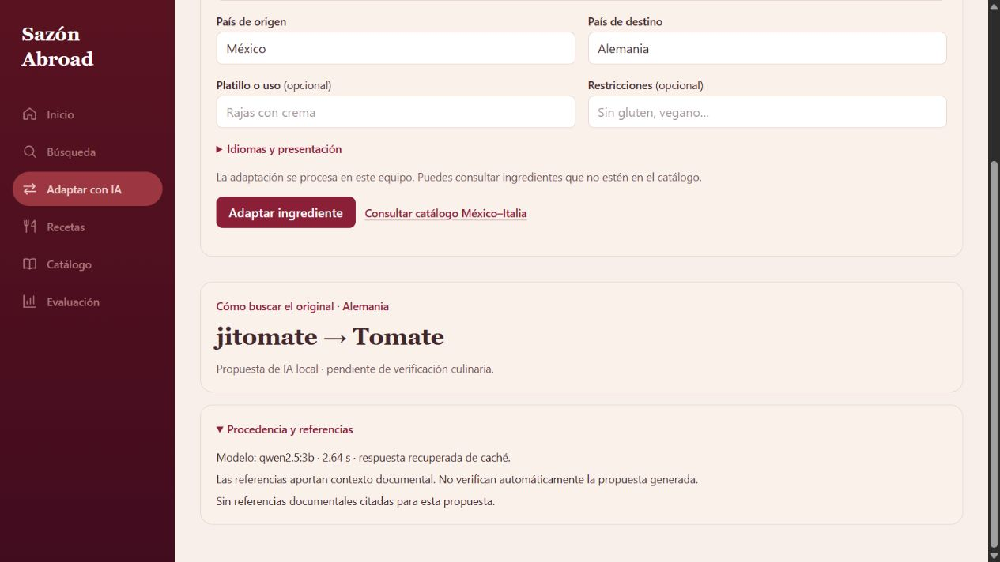

# Fase 1: implementación y validación técnica

Fecha: 24 de noviembre de 2026. Estado: base técnica completada; calidad culinaria experimental.

## Resultado implementado

La ruta `/adaptar`, accesible desde **Adaptar con IA**, acepta ingredientes nuevos, preguntas libres, países, idiomas, uso, presentación y restricciones. No requiere un ID del catálogo. México → Italia es la configuración inicial; otros trayectos siguen siendo experimentales.

El catálogo existente aporta identidades y relaciones documentales cuando corresponden al trayecto y al uso. La IA selecciona opciones de ese contexto o genera propuestas para entradas no cubiertas. Las notas documentales reconocidas se conservan para evitar que una reformulación altere sus ajustes o limitaciones. No se amplió la lista de ingredientes ni se añadió una base vectorial.

Las consultas breves de nombre solicitan solo un término local. Las consultas contextuales usan un contrato con modos excluyentes: identidad/descripción, sustitución y abstención/aclaración. La validación del servidor comprueba formato, coherencia e IDs de fuentes; la caché separa contexto, restricciones, idiomas, país, configuración y versión del prompt.

## Entorno comprobado

| Componente | Valor |
| --- | --- |
| Ollama portátil | 0.40.18, instalado en `.runtime/ollama/`. |
| Modelo inicial | `qwen2.5:3b`, Instruct, cuantización `Q4_K_M`. |
| Digest del modelo | `357c53fb659c5076de1d65ccb0b397446227b71a42be9d1603d46168015c9e4b`. |
| Ejecución | CPU; la API informó 0 bytes de VRAM y 2.168.371.280 bytes residentes. |
| Contexto y salida | 4096 y 1200 tokens, respectivamente. |
| Tiempo máximo de transporte | 120 segundos. |
| Prompt final comprobado | `culinary-v10`. |

La descarga del modelo se verificó por SHA-256 y se registró en Ollama. La instalación usa `OLLAMA_NO_CLOUD=1`; el cliente de la aplicación consulta exclusivamente una dirección de loopback, sin proxies ni redirecciones y sin fallback a una API remota. Los binarios, pesos y diagnósticos locales están excluidos de Git.

Las primeras pruebas con Qwen3 detectaron incompatibilidades entre la configuración de razonamiento y la plantilla del modelo, latencia excesiva por CPU y salidas incorrectas al intentar forzar una respuesta directa. Se eligió una variante Instruct para este prototipo. Esos ensayos de desarrollo no son una comparación controlada de familias o tamaños.

## Pruebas automáticas

`python -m unittest discover -s tests` ejecutó **40 pruebas correctas**, incluidas las 13 originales. Las nuevas comprobaciones cubren consultas sin ID, separación de países e idiomas, caducidad y aislamiento de caché, configuración local, capacidades de razonamiento, errores de transporte, respuestas inválidas, referencias inventadas, no equivalencias y presentación segura de los resultados.

Se compiló el CSS con `npm run build:css` y se comprobó el diff con `git diff --check`. Se conservaron el buscador, las recetas y la evaluación histórica.

## Inferencia real y navegador

Estos son casos de humo usados durante el desarrollo, no un conjunto reservado ni una evaluación de aceptación culinaria.

| Consulta | Observación en la ejecución final | Tiempo de servicio |
| --- | --- | ---: |
| Jitomate, México → Italia | `pomodoro`; identidad documentada, sin uso ni sustituciones inventadas. | 2,16 s |
| ¿Qué uso en vez de poblano para rajas? | `Peperone verde` en alternativas; el original no se renombra como morrón; conserva las limitaciones documentadas. | 31,34 s |
| Masa harina para tortillas | `farina di mais nixtamalizzata` como término del original; sin sustitutos; advertencias documentadas sobre polenta y envase. | 32,30 s |
| Anís estrellado, México → Italia | `Anice Stellato`; propuesta generada fuera del catálogo, sin fuentes inventadas. | 2,12 s |
| Jitomate, México → Alemania | `Tomate`, comprobado mediante el formulario real con idioma de destino `de`. | 2,64 s |

El navegador confirmó que repetir la consulta alemana recupera la respuesta de caché. Se revisaron formulario, resultado, desplegables y estados de fallo en escritorio y móvil. La captura muestra la respuesta real del modelo y su estado pendiente de verificación.



La prueba CLI se reproduce con:

```powershell
.\.venv\Scripts\python -X utf8 scripts/check_local_ai.py --diagnostics --output .runtime/local-ai-smoke.json
```

El archivo de esa ejecución y `.runtime/validated-runtime.json` guardan las respuestas y la configuración local para inspección. No forman parte del catálogo ni se presentan como propuestas aceptadas. La [guía de IA local](ia-local.md) explica cómo iniciar Ollama y Flask después de la verificación.

## Límites observados y siguiente trabajo

La validación estructural no verifica el significado de un alimento. Durante el desarrollo, el modelo confundió hojas de curry con hojas de cúrcuma y produjo `Anis gestreift` para anís estrellado en alemán. Son errores reales de conocimiento/traducción, no ejemplos válidos. Estos hallazgos impiden presentar la cobertura universal como fiable en esta fase.

Las notas documentadas ayudan en los casos ya cubiertos. Las entradas nuevas dependen del conocimiento del modelo y requieren revisión. Los filtros léxicos de intención y restricciones son iniciales; no constituyen comprensión universal de preguntas ni validación de restricciones alimentarias.

Las consultas contextuales de esta ejecución superaron el objetivo provisional de 15 segundos. Esta muestra no permite estimar p95 ni aceptación culinaria. La fase de evaluación debe usar casos nuevos, revisión humana y mediciones suficientes antes de declarar alcanzadas esas metas o habilitar otros trayectos como estables. La recuperación adicional de evidencia se decidirá por su mejora medida, sin asumir que una base vectorial sea necesaria.

La siguiente fase de implementación es compactar las fichas heredadas. Recetas libres y comercios siguen en sus fases posteriores del [plan](plan-adaptacion-ia-local.md).
