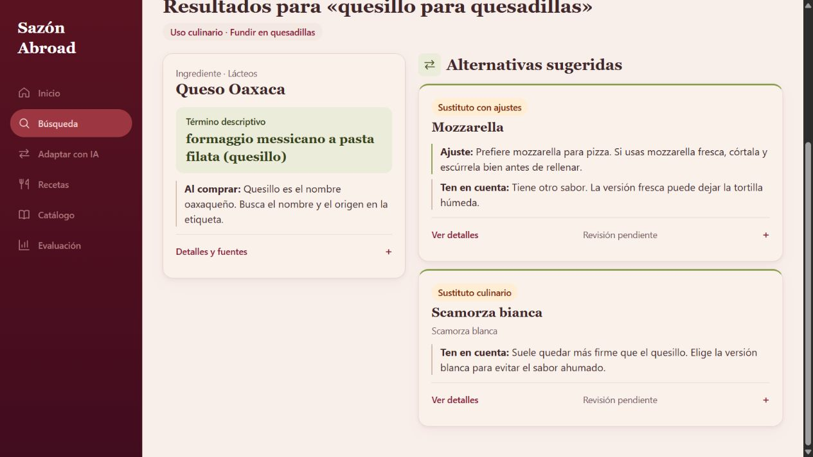

# Fase 2: fichas compactas y detalle bajo demanda

Fecha: 24 de noviembre de 2026. Estado: completada y verificada técnicamente.

## Comportamiento

La vista inicial muestra el ingrediente, el nombre local, el tipo de relación y las indicaciones necesarias para usarlo. Los ajustes y limitaciones se conservan completos, sin recortes, puntos suspensivos ni límites de líneas. Las notas de compra y las advertencias de no equivalencia siguen visibles.

Los motivos, propiedades, nombres alternativos, evidencia, fuentes y créditos de fotos se consultan desde **Ver detalles** o **Detalles y fuentes**. El estado de revisión del sustituto permanece visible en el propio control, incluso cerrado. Las miniaturas se integran en la cabecera de la tarjeta.

La búsqueda y el catálogo comparten componentes. Los usos del mismo producto se agrupan sin mezclar sustituciones con advertencias y conservando el orden de recuperación. Se muestran hasta dos alternativas inicialmente; las adicionales se expanden con **Ver más alternativas**. Las advertencias no están sujetas a ese límite. Cuando el uso no está documentado, la búsqueda ofrece un enlace al modo de IA.

En recetas, el ajuste y la limitación del sustituto elegido quedan fuera del desplegable de explicación. En **Adaptar con IA**, el resumen adicional queda bajo demanda; aclaraciones, ajustes, limitaciones, advertencias y el estado pendiente de verificación permanecen visibles.

Los desplegables usan HTML nativo. Abrirlos revela el contenido ya disponible: no genera otra explicación, no llama al modelo y no cambia el producto propuesto. La ampliación adicional con IA no forma parte de esta entrega.

## Verificación

Pasaron **46 pruebas automáticas**, incluidas las 40 anteriores. Las seis comprobaciones nuevas protegen:

- Ajustes completos y advertencias —incluido «Contiene gluten»— visibles en búsqueda.
- Todas las advertencias visibles aunque haya más de dos.
- Solo las alternativas adicionales cerradas inicialmente, usando una fixture de tres productos para comprobar presentación, no pertinencia culinaria.
- Agrupación por producto y tipo sin alterar la prioridad ni duplicar tarjetas en catálogo.
- Notas esenciales visibles al seleccionar mozzarella en una receta.
- Avisos de IA visibles y explicación/resumen bajo desplegables.

Comandos ejecutados:

```powershell
.\.venv\Scripts\python -m unittest discover -s tests
npm run build:css
git diff --check
```

El navegador comprobó la búsqueda de quesillo para quesadillas, las advertencias de masa harina para tortillas, la ficha de poblano en catálogo y la receta de quesadillas con mozzarella seleccionada. Se abrió la explicación y se cerró con Enter. La vista móvil a 390 píxeles de ancho no mostró desbordamiento horizontal y mantuvo legibles los ajustes y las limitaciones.

## Comparación observada

Para `quesillo para quesadillas`, con los desplegables cerrados y el mismo tamaño de ventana:

| Medida del bloque de resultados | Antes | Después | Reducción |
| --- | ---: | ---: | ---: |
| Palabras visibles (`innerText`) | 148 | 112 | 24,3 % |
| Altura del bloque | 865 px | 680 px | 21,4 % |

Es una comparación de una pantalla concreta, no una estimación de todas las fichas ni una medida de calidad culinaria. El ajuste completo de la mozzarella, su advertencia de humedad y la limitación de la scamorza siguen visibles.



[Captura de la revisión móvil](images/fase-2-movil.jpg)

## Alcance y continuación

Se modificaron la presentación y la agrupación de tarjetas. Se conservaron las relaciones, las fuentes, los filtros de rechazo, las cantidades y los pasos de las recetas. El modelo y su validación culinaria experimental continúan según el [registro de la fase 1](fase-1-validacion.md).

La siguiente fase es buscar o introducir una receta, revisar sus ingredientes y obtener una lista adaptada sin depender de las recetas precargadas. Los comercios y precios permanecen en la fase posterior del [plan](plan-adaptacion-ia-local.md).
